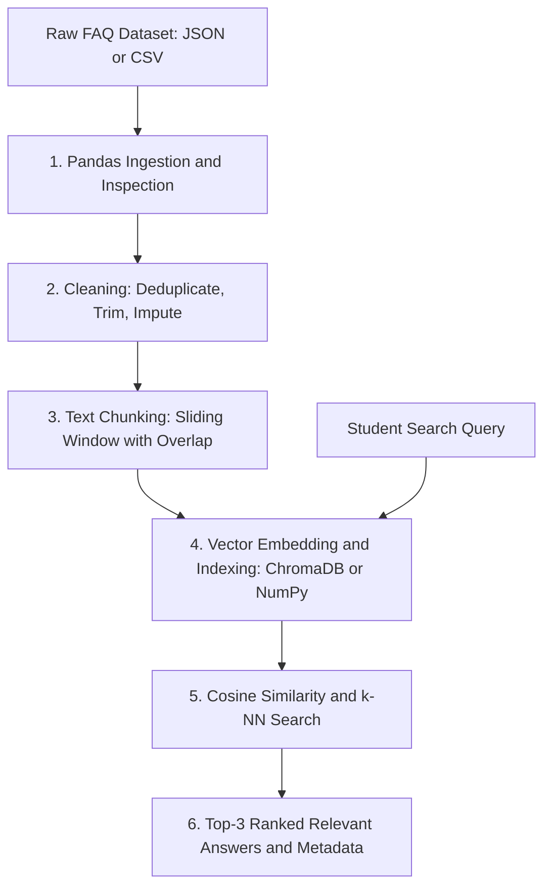

# Week 2: Mini Semantic Search Engine

> **AI / ML AWS AASTU Cohort · Lecture 2 Deliverable**  
> *From messy data to search that understands meaning*

---

## 📌 Project Overview

Traditional search systems rely on strict keyword matching. If a student asks *"How do I connect to campus internet?"*, a keyword index looks for the exact word *"internet"*. If the FAQ entry is titled *"AASTU High-Speed Wi-Fi Access"*, keyword search can return zero results.

This project implements a **Mini Semantic Search Engine** over an Addis Ababa Science and Technology University (AASTU) knowledge base. By mapping questions and answers into high-dimensional vector representations, the system measures **semantic similarity** (direction of vectors) rather than lexical overlap.

---

## 🏛️ Pipeline Architecture



### The Two-Lane Pipeline
Real-world enterprise data combines **structured** and **unstructured** information:
1. **Structured Lane**: Category, Department, ID, Last Updated. Filtered using relational/metadata rules.
2. **Unstructured Lane**: Text descriptions, questions, answers. Cleaned, chunked, embedded, and queried via vector distance.

---

## 📂 Repository Structure

```text
week-02/
├── README.md               # Deliverable documentation and usage instructions
├── requirements.txt        # Core dependencies (pandas, numpy, chromadb)
├── data/
│   ├── faqs.json           # AASTU Knowledge Base (JSON format)
│   └── faqs.csv            # AASTU Knowledge Base (CSV format)
├── task.py                 # Modular CLI application for indexing and searching
└── task.ipynb              # Colab & Jupyter-ready walkthrough notebook
```

---

## ⚙️ Installation & Setup

### 1. Activate Environment
Ensure your Python virtual environment is activated:
```bash
# Windows
.venv\Scripts\activate

# Linux / macOS
source .venv/bin/activate
```

### 2. Install Dependencies
```bash
pip install -r week-02/requirements.txt
```

---

## 🚀 How to Run

### Option A: Command-Line Interface (`task.py`)

#### 1. Run Built-In Demonstration Queries
```bash
python week-02/task.py
```

#### 2. Query with Custom Natural Language
```bash
python week-02/task.py --query "How do I connect to campus wifi?" --top-k 3
```

#### 3. Query with Metadata Filtering (Hybrid Search)
```bash
python week-02/task.py --query "Where do I register?" --category "Campus Services"
```

#### 4. Interactive Search Loop
```bash
python week-02/task.py --interactive
```

---

### Option B: Interactive Jupyter Notebook (`task.ipynb`)

Launch the notebook to inspect interactive code cells, outputs, and step-by-step explanations:
```bash
jupyter notebook week-02/task.ipynb
```
*The notebook is also 100% compatible with Google Colab.*

---

## 🔍 Example Query Results

### Query 1: *"How do I connect to campus wifi?"*
```text
======================================================================
QUERY: "How do I connect to campus wifi?"
======================================================================

[Match 1] Relevance Score: 0.3107
  Category:   IT Services | Department: ICT Directorate
  Question:   How do I connect to the AASTU high-speed campus Wi-Fi network?
  Answer:     Connect your laptop or smartphone to the 'AASTU-Student' SSID. When prompted, 
              use your university institutional email address (e.g. firstname.lastname@aastu.edu.et) 
              as the username and your SIMS portal password...
```

### Query 2: *"What happens if my CGPA is below 2.0?"*
```text
======================================================================
QUERY: "What happens if my CGPA is below 2.0?"
======================================================================

[Match 1] Relevance Score: 0.4797
  Category:   Academics & Grading | Department: Academic Affairs
  Question:   How does the AASTU grading system work and what is considered academic probation?
  Answer:     AASTU operates on a standard 4.00 Grade Point Average (GPA) scale... A cumulative 
              GPA (CGPA) or semester GPA (SGPA) below 2.00 places an undergraduate student on 
              Academic Probation...
```

---

## 🧠 Key Technical Concepts

1. **NumPy Vectorization**: Batch numerical operations without Python loops (`prices * 1.15`).
2. **Text Chunking with Overlap**:
   ```python
   def chunk(words, size=80, overlap=20):
       step = size - overlap
       return [words[i:i + size] for i in range(0, len(words), step)]
   ```
   *Overlap preserves semantic context at document boundaries so sentences are not broken mid-thought.*
3. **Cosine Similarity**:
   $$\text{Cosine Similarity}(A, B) = \frac{A \cdot B}{\|A\| \|B\|}$$
   *Measures the angle between vectors: $1.0$ = identical direction, $0.0$ = unrelated, $-1.0$ = opposite.*
4. **Vector Databases & Approximate Nearest Neighbors (ANN)**:
   * Replaces brute-force exhaustive search ($O(N)$) with graph-based indexing (HNSW) and cluster partitioning (IVF) for sub-second retrieval over millions of records.
