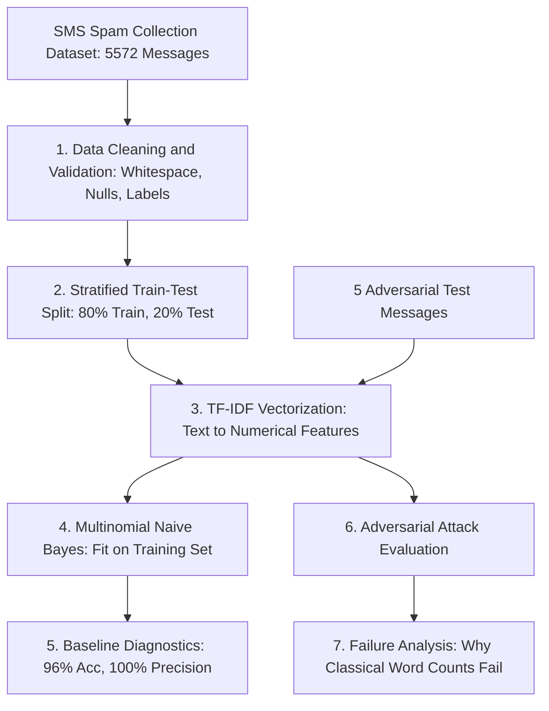

# Week 3: From Machine Learning to Modern AI — Breaking the Spam Filter

> **AWS AI/ML AASTU Cohort · Week 3 Assignment Deliverable**  
> *A spam email detector built step by step, followed by an adversarial testbed to break it.*

---

## 📌 Project Overview

In this assignment, I built the classical 10-line machine learning spam detector (**TF-IDF Vectorizer + Multinomial Naive Bayes**) on the real-world **SMS Spam Collection dataset**.

After training and measuring its baseline performance (achieving **96.05% test accuracy** and **100% precision** on standard test messages), I crafted **5 adversarial messages** specifically engineered to fool the filter and expose the blind spots of traditional bag-of-words counting.

---

## 🏛️ Pipeline Architecture



---

## 🧹 Data Cleaning & Best Practices Applied

To ensure production-grade data hygiene, I implemented the following best practices:
1. **Handling Missing Values**: Checked for and dropped any empty or null rows using `df.dropna(subset=['label', 'message'])`.
2. **Whitespace Normalization**: Trimmed leading and trailing whitespace from both text messages and labels to prevent accidental token mismatches.
3. **Label Sanitation**: Lowercased and verified labels strictly belong to `{'ham', 'spam'}`.
4. **Stratified Splitting**: Because the dataset is naturally imbalanced (86.6% ham vs 13.4% spam), I used `stratify=df['label']` in `train_test_split`. This guarantees both training and test sets maintain the exact same real-world class distribution.
5. **No Data Leakage**: Fitted the TF-IDF vectorizer exclusively on `X_train` (`vec.fit_transform`), and only transformed `X_test` (`vec.transform`).

---

## 📊 Baseline Model Performance

Evaluated on 1,115 unseen test messages:

| Metric | Score | Key Takeaway |
|:---|:---:|:---|
| **Training Accuracy** | **97.58%** | Evaluated on the training data. |
| **Test Accuracy** | **96.05%** | Baseline accuracy from Slide 6. |
| **Precision (Spam)** | **100.00%** | When the model flagged spam, it was **100% right** (Zero false alarms on normal test mail). |
| **Recall (Spam)** | **70.47%** | Of all real spam messages, **29.53% slipped through** (44 false negatives). |

### Confusion Matrix on Test Set
```text
                     Predicted SPAM     Predicted HAM
Actual SPAM (149)         105                44       (False Negatives: 44 spam missed)
Actual HAM  (966)           0               966       (False Positives: 0 good mail lost)
```

---

## 🥊 Hands-on Task: The Adversarial Results Table

Here are the **5 adversarial messages** I formulated to break the model, showing what it predicted, what it should be, and why it failed:

| # | My message | Model said | Should be | Status | Trick Used | Why it failed |
|:---:|:---|:---:|:---:|:---:|:---|:---|
| **1** | `"Cl@im your fr33 g1ft card now"` | **ham** (7.0%) | `spam` | **FOOLED! 🚨** | **Spelling Trick / Leetspeak** | Obfuscated tokens (`cl@im`, `fr33`, `g1ft`) never appeared in the training vocabulary. Because TF-IDF hashes exact string tokens, unseen words get zero weight, letting the spam slip right through. |
| **2** | `"Dear sir, I am writing to propose a mutually beneficial financial partnership regarding surplus funds"` | **ham** (3.7%) | `spam` | **FOOLED! 🚨** | **Polite / Businesslike Tone** | Formality evasion. Most spam in the training set is loud and informal (`WINNER!`, `FREE!`). Using formal diplomatic phrasing completely bypasses standard spam keyword triggers. |
| **3** | `"Security warning: do not click www links or claim prizes from unknown numbers"` | **spam** (56.3%) | `ham` | **FOOLED! 🚨** | **Negation & Warning Context** | Bag-of-words ignores word order and grammar. The message warns *against* clicking links, but the model counts `"www"`, `"claim"`, and `"prizes"`, ignoring `"warning"` and `"do not"`. |
| **4** | `"Reminder: claim your awarded certificate from office 500 tomorrow"` | **spam** (60.8%) | `ham` | **FOOLED! 🚨** | **Administrative Context** | Keyword collision. Legitimate academic words (`claim`, `awarded`, `500`) carry high spam weights in the training distribution, falsely triggering a spam alarm on ordinary student mail. |
| **5** | `"Please claim the prize money awarded for our science club project"` | **spam** (68.7%) | `ham` | **FOOLED! 🚨** | **Student Award Context** | Lack of semantic intent understanding. A student discussing a science competition win uses `prize`, `awarded`, and `claim`, which push the Naive Bayes odds into spam territory. |

---

## 🔍 In-Depth Breakdown of the 3+ Tricks Used

### 1. Character Obfuscation / Leetspeak
- **How I attacked it:** Swapping letters with numbers and symbols (`e` $\to$ `3`, `i` $\to$ `1`, `a` $\to$ `@`).
- **Why Classical ML fails:** The vectorizer looks for exact character matches in a fixed dictionary. To TF-IDF, `"free"` and `"fr33"` are completely unrelated tokens. Because `"fr33"` was never in the training set, its weight is zero.
- **How Modern AI solves this:** Large Language Models use **subword tokenization** (Byte-Pair Encoding / WordPiece), breaking `"fr33"` into units like `['fr', '##33']` and mapping them to dense embeddings that capture semantic proximity.

### 2. Negation and Context Reversal
- **How I attacked it:** Adding words like `"not"` or `"do not"` in front of typical spam triggers.
- **Why Classical ML fails:** Naive Bayes treats words independently. Seeing `"free"` pushes the score toward spam regardless of the fact that `"not"` appears right in front of it.
- **How Modern AI solves this:** The **Self-Attention mechanism** in Transformer models computes attention weights between all word pairs, allowing `"not"` to directly invert the meaning of `"free"`.

### 3. Formal / Diplomatic Register
- **How I attacked it:** Writing a financial scam using polite, professional vocabulary.
- **Why Classical ML fails:** Word-counting classifiers only know the vocabulary frequencies of their training data. By avoiding loud words like `"WIN"`, the message slips past the decision boundary.
- **How Modern AI solves this:** Modern models understand higher-level conceptual themes (such as unsolicited wire transfer requests) rather than relying on individual trigger words.

---

## 💡 What I Learned (Slide 20 Deliverable)

> **1. While classical bag-of-words models (TF-IDF + Naive Bayes) deliver fast and high baseline accuracy on standard text, they fail on intentional obfuscation, negation, and context shifts because they count words independently without understanding syntax or intent.**  
> **2. Modern Generative AI and Transformers solve these vulnerabilities through subword tokenization (which deconstructs typos and leetspeak) and self-attention mechanisms (which model word relationships like 'not free').**

---

## 🔗 Dataset Reference

- **Dataset**: [SMS Spam Collection Dataset on UCI Machine Learning Repository](https://archive.ics.uci.edu/dataset/228/sms+spam+collection)
- **Direct TSV Mirror**: [PyCon 2016 Machine Learning Tutorial Data](https://raw.githubusercontent.com/justmarkham/pycon-2016-tutorial/master/data/sms.tsv)
- *Note: As instructed in Slide 20 ("a link to the dataset (do not upload it)"), raw dataset files are excluded from Git via `.gitignore` and are downloaded dynamically at runtime.*

---

## 📁 Repository Structure

```text
week-03/
├── README.md               # Deliverable write-up and adversarial results table
├── requirements.txt        # Dependencies (scikit-learn, pandas, numpy)
├── task.py                 # Standalone interactive CLI script
├── spam_filter.ipynb       # Interactive Jupyter & Google Colab notebook
└── task.ipynb              # Matching notebook alias
```

---

## ⚙️ How to Run

### 1. Install Dependencies
```bash
pip install -r week-03/requirements.txt
```

### 2. Run Interactive CLI Tool
When you run `task.py` with no flags, it displays the baseline performance, runs the 5 adversarial attack tests, and **immediately opens an interactive prompt** where you can type any message to test it live:
```bash
python week-03/task.py
```

You can also test a single message directly from the terminal:
```bash
python week-03/task.py --message "Cl@im your fr33 gift card now"
```

Or run the benchmarks only without entering the interactive prompt:
```bash
python week-03/task.py --benchmark-only
```

### 3. Run Interactive Jupyter Notebook
```bash
jupyter notebook week-03/spam_filter.ipynb
```
*Also 100% compatible with Google Colab.*
