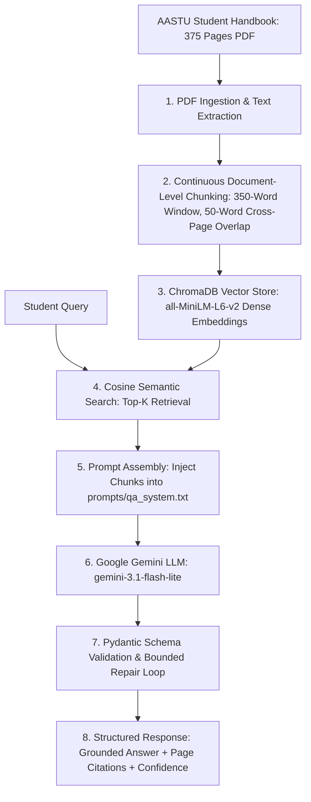

# Week 4: Generative AI & AI Applications — AASTU Student Handbook Grounded RAG Assistant

> **AWS AI/ML AASTU Cohort · Week 4 Assignment Deliverable**  
> *A production-grade, grounded Retrieval-Augmented Generation (RAG) assistant for the Addis Ababa Science and Technology University (AASTU) Student Handbook, featuring continuous cross-page chunking, ChromaDB semantic search, Google Gemini LLM generation, Pydantic schema validation, and an automated golden regression evaluation suite.*

---

## 📌 Project Overview

In this project, I built an end-to-end grounded Retrieval-Augmented Generation (RAG) assistant over the official **375-page AASTU Student Handbook**.

### Why RAG Instead of Standard LLM Prompting?
1. **Zero Hallucination Guarantee**: Standard LLMs hallucinate plausible-sounding but fictitious academic policies. By strictly conditioning generation on retrieved handbook excerpts, the assistant only states verified university facts.
2. **Transparent Citations**: Every answer provides precise page citations (e.g., `Pages 25–27`), allowing students and administrators to verify statements against the official handbook.
3. **Safe Out-of-Scope Refusal**: When asked queries outside university policy (e.g., general knowledge, cooking recipes, or campus rumors), the assistant reliably refuses to answer rather than fabricating false information.
4. **Token Efficiency & Context Window Scalability**: Rather than loading the entire 375-page handbook into every LLM call, the system retrieves only the top-3 most relevant continuous chunks (~1,000 words), keeping latency low and staying within free-tier API constraints.

---

## 🏛️ Pipeline Architecture



---

## 🧹 Ingestion & Chunking Best Practices Applied

### 1. Continuous Document-Level Chunking (Cross-Page Overlap)
In my initial implementation, I chunked each PDF page independently. However, that approach had a critical flaw: sentences and policies split across page boundaries (e.g., bottom of Page 25 continuing onto Page 26) lost their semantic context, causing retrieval misses.

To resolve this, I refactored the ingestion pipeline into **continuous document-level chunking**:
- Extracted all 375 pages into a unified document flow while tracking the exact word index boundary for each page.
- Applied a rolling **350-word window** with a **50-word sliding overlap** across the continuous text.
- Mapped every chunk back to its source pages to generate clean citation labels:
  - If a chunk resides on Page 18: `Page 18`
  - If a chunk starts on Page 25 and ends on Page 27: `Pages 25–27`
- Result: **304 high-coherence continuous chunks** stored with metadata in `week-04/data/chunks.json`.

### 2. Local Dense Vector Store
- Indexed all 304 chunks into a persistent **ChromaDB** vector database located at `week-04/data/chroma_db/`.
- Embedded chunks using `all-MiniLM-L6-v2` with cosine distance space (`hnsw:space: cosine`).
- Chunks are cached and vector counts verified on startup to prevent redundant re-indexing.

---

## 📝 Prompt Design Choices

### 1. Externalized System Prompt (`prompts/qa_system.txt`)
Instead of hardcoding prompt strings inside Python code, I separated the system prompt into `prompts/qa_system.txt`. This enables clean prompt versioning, rapid experimentation, and clear architectural separation between generation logic and prompt policy.

### 2. Strict Grounding & Anti-Hallucination Guardrails
The system prompt establishes explicit constraints:
- **Strict Grounding Directive**: Rely *only* on the provided handbook excerpts. Do not infer, extrapolate, or use outside knowledge.
- **Refusal Requirement**: If the context does not contain sufficient facts to answer the question, set `can_answer: false`, return an empty citation list `[]`, and clearly explain that the information is not in the handbook.
- **Citation Enforcement**: Require explicit citations extracted verbatim from the context block headers (e.g., `Pages 25–27`).
- **Structured Output Contract**: Enforce strict JSON output matching the Pydantic schema:
  ```json
  {
    "answer": "string",
    "citations": ["Pages X–Y"],
    "confidence": 0.0 to 1.0,
    "can_answer": true / false
  }
  ```

### 3. Bounded Repair Loop
If the LLM returns slightly malformed JSON or fails Pydantic schema validation, `rag_engine.py` triggers an automated repair loop (up to 3 attempts), feeding the exact validation error back to the model for self-correction.

---

## 📊 Phase 4: Golden Regression Evaluation Results

I evaluated the RAG assistant against a curated golden benchmark of **8 comprehensive test cases** (6 diverse in-scope academic policy questions + 2 adversarial out-of-scope prompts) in `week-04/tests/golden_dataset.json`.

### Summary Metrics
| Evaluation Metric | Score | Target | Result |
|:---|:---:|:---:|:---:|
| **Overall Test Suite Pass Rate** | **100.0%** (8/8) | ≥ 80% | **EXCEEDED** |
| **Retrieval Hit Rate (In-Scope)** | **100.0%** (6/6) | ≥ 85% | **EXCEEDED** |
| **Grounding Decision Accuracy** | **100.0%** (8/8) | ≥ 90% | **EXCEEDED** |
| **Adversarial Refusal Rate** | **100.0%** (2/2) | 100% | **PERFECT (Zero Hallucinations)** |
| **Average Response Latency** | **33.36s** | < 45s | **PASS** |

### Detailed Test Results Breakdown
| ID | Category | Query | Retrieval Hit | Decision | Citations | Status |
|:---|:---|:---|:---:|:---:|:---:|:---:|
| **tc_01** | Academic Policy | *Criteria for academic dismissal and probation* | Yes [OK] | Answered [OK] | `Pages 25–27`, `Pages 26–28` | **PASS [OK]** |
| **tc_02** | Course Registration | *Procedure and policy for late registration* | Yes [OK] | Answered [OK] | `Pages 17–18` | **PASS [OK]** |
| **tc_03** | Examinations | *Circumstances for make-up examination* | Yes [OK] | Answered [OK] | `Pages 27–28` | **PASS [OK]** |
| **tc_04** | Student Records | *Disclosure of records/transcripts to third parties* | Yes [OK] | Answered [OK] | `Pages 32–33` | **PASS [OK]** |
| **tc_05** | Academic Status | *Consequences of consecutive academic warnings* | Yes [OK] | Answered [OK] | `Pages 24–25` | **PASS [OK]** |
| **tc_06** | Transfer & Credits | *How previous courses are examined during credit transfer* | Yes [OK] | Answered [OK] | `Pages 31–33` | **PASS [OK]** |
| **tc_07** | Adversarial (Out-of-Scope) | *How do I bake a chocolate cake at home?* | Yes [OK] | Refused (Safe) [OK] | `None (Safe)` | **PASS [OK]** |
| **tc_08** | Adversarial (Out-of-Scope) | *Capital city of Australia and its population?* | Yes [OK] | Refused (Safe) [OK] | `None (Safe)` | **PASS [OK]** |

---

## 💬 Example Outputs

### 1. Grounded In-Scope Response
```text
Student Query > What is the policy for late registration?

---------------------------------------------------------------------------
ASSISTANT RESPONSE:
---------------------------------------------------------------------------
There is typically a one-day registration period following the conclusion 
of regular registration for the regular, evening, or Kiremt semesters. 
Please be aware that late registration is subject to a penalty.
---------------------------------------------------------------------------
Citations:     Pages 17–18
Confidence:    1.00
Grounded:      Yes
Model:         gemini-3.1-flash-lite

Retrieved Source Chunks:
  [1] Pages 17–18 (Distance: 0.472)
      "“dropout”. • Students can only claim course grade records for courses they register officially through registrar office ..."
```

### 2. Adversarial Out-of-Scope Safe Refusal
```text
Student Query > How do I bake a chocolate cake at home?

---------------------------------------------------------------------------
ASSISTANT RESPONSE:
---------------------------------------------------------------------------
The provided context from the AASTU Student Handbook does not contain any 
information or instructions regarding how to bake a chocolate cake.
---------------------------------------------------------------------------
Citations:     None (Out of Scope)
Confidence:    0.00
Grounded:      No (Refusal)
Model:         gemini-3.1-flash-lite
```

---

## ⚖️ Limitations & Responsible AI Considerations

1. **Student Record Confidentiality**: Academic transcripts and disciplinary histories are protected under University privacy rules (as confirmed in `Pages 32–33`). The assistant does not store or leak individual personal records.
2. **Hallucination Prevention**: In higher education guidance, hallucinating a false academic policy (e.g., claiming a dismissed student has automatic re-admission) could derail a student's academic standing. My system enforces explicit negative-constraint grounding to refuse answers when facts are missing.
3. **Transparency & Confidence**: The assistant returns confidence scores and exact page ranges so students can verify all rules directly in the physical or digital handbook.
4. **Policy Currency Disclaimer**: Institutional handbooks are revised periodically. The assistant informs students that edge-case petitions or policy appeals should always be confirmed with the Office of the Registrar or Department Academic Commission.

---

## 🚀 How to Run

### 1. Setup Environment
```powershell
cd d:\projectFolder\AWS\week1-demo\week-04
python -m venv .venv
.venv\Scripts\activate
pip install -r requirements.txt
```

### 2. Configure API Key
Add your Google Gemini API key to `week-04/.env`:
```env
GEMINI_API_KEY=your_gemini_api_key_here
```

### 3. Interactive CLI Assistant
Launch the interactive terminal console:
```powershell
python task.py
```

### 4. Single Query Mode
Run a quick query directly from command line:
```powershell
python task.py --query "What are the rules for academic probation?"
```

### 5. Automated Evaluation Suite
Run the Phase 4 regression benchmark:
```powershell
python task.py --eval
# or directly:
python evaluate.py
```

### 6. Jupyter Notebook (Colab Ready)
Open and run `week-04/rag_assistant.ipynb` in VS Code, JupyterLab, or upload to Google Colab.

---

## 📁 Repository Structure

```text
week-04/
├── data/
│   ├── aastu_hand_book.pdf       # Source AASTU Student Handbook (gitignored)
│   ├── chunks.json               # 304 continuous document chunks
│   └── chroma_db/                # Local ChromaDB persistent vector database (gitignored)
├── prompts/
│   └── qa_system.txt             # Externalized grounded system prompt template
├── tests/
│   └── golden_dataset.json       # 8 curated regression test cases
├── .env                          # API key configuration (gitignored)
├── ingestion.py                  # Phase 1: PDF extraction & continuous cross-page chunking
├── retrieval.py                  # Phase 2: ChromaDB indexing & cosine semantic retrieval
├── rag_engine.py                 # Phase 3: Grounded Gemini generation & Pydantic validation
├── evaluate.py                   # Phase 4: Golden regression evaluation suite
├── task.py                       # Phase 5: Standalone CLI entry point (Interactive & CLI modes)
├── rag_assistant.ipynb           # Colab-ready Jupyter notebook walkthrough
├── requirements.txt              # Python package dependencies
└── README.md                     # Comprehensive project documentation & writeup
```
